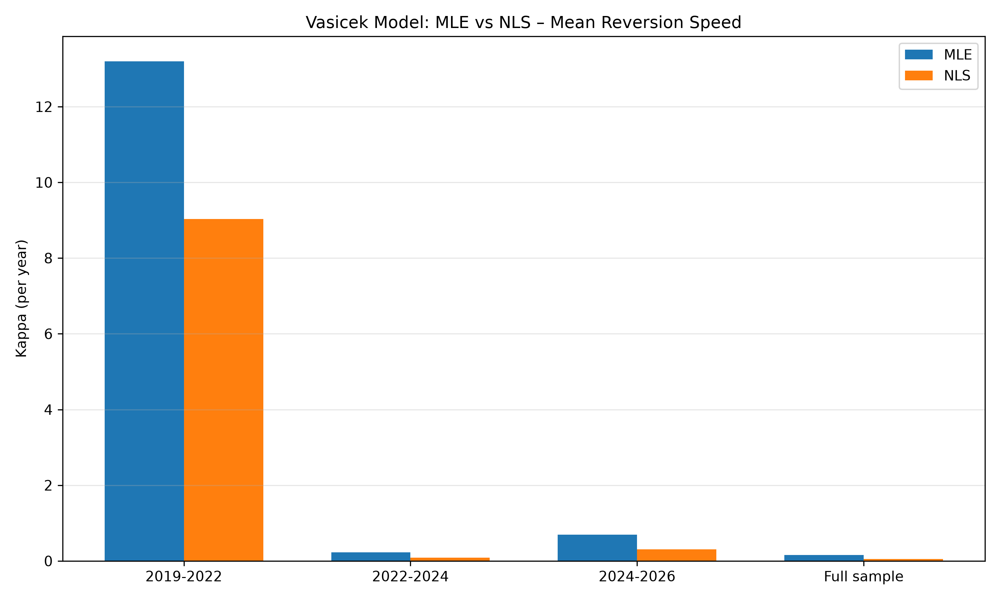
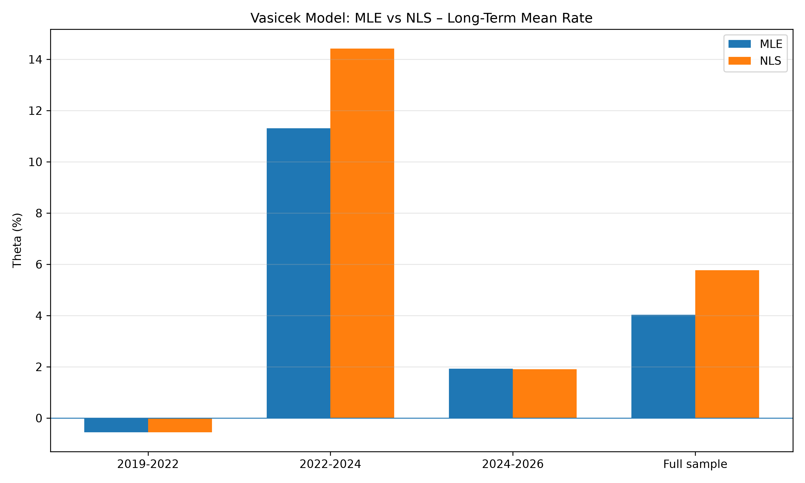

# Vasicek Short-Rate Model: Calibration, Simulation and Robustness Analysis

## 1. Project Overview

This project applies the Vasicek short-rate model to historical Euro Short-Term Rate (€STR) data.

The objective is to estimate the dynamics of short-term interest rates, simulate possible future interest-rate paths and evaluate the stability of model parameters across different interest-rate regimes.

The project focuses on several quantitative finance concepts relevant to financial risk management:

- Short-rate modelling
- Mean reversion
- Maximum Likelihood Estimation (MLE)
- Nonlinear Least Squares (NLS)
- Monte Carlo simulation
- Parameter stability and robustness
- Interest-rate regime analysis

## 2. The Vasicek Model

The Vasicek model is a one-factor mean-reverting short-rate model defined by the stochastic differential equation:

$$
[
dr_t = \kappa(\theta-r_t)dt+\sigma dW_t
]
$$

Where:
$$
- (r_t) – instantaneous short-term interest rate
- (\kappa) – speed of mean reversion
- (\theta) – long-term mean interest rate
- (\sigma) – interest-rate volatility
- (dW_t) – increment of a standard Brownian motion
$$

Parameter Interpretation

Mean reversion speed (κ)

Measures how quickly interest rates return towards their long-term mean.

Long-term mean (θ)

Represents the theoretical equilibrium level towards which interest rates tend to revert.

Volatility (σ)

Measures the instantaneous volatility of interest-rate movements.

The half-life of a deviation from the long-term mean is calculated as:

$$
[
t_{1/2}=\frac{\ln(2)}{\kappa}
]
$$

It represents the time required for half of the deviation from the long-term mean to disappear.

## 3. Data

The model uses historical Euro Short-Term Rate (€STR) observations obtained from the European Central Bank (ECB).

The dataset covers:

- Start date: 1 October 2019
- End date: 28 October 2026
- Number of observations: 1,813
- Historical average: approximately 1.336%
- Minimum observed rate: approximately -0.593%
- Maximum observed rate: approximately 3.913%

Data Preparation

The original ECB dataset was cleaned using Python and pandas.

The preparation process included:

1. Selecting the observation date and interest-rate columns.
2. Converting dates and interest rates into appropriate numerical formats.
3. Sorting observations chronologically.
4. Removing duplicate observations.
5. Checking for missing values.
6. Converting interest rates from percentage values into decimal form.

The cleaned dataset contains the following variables:

- "date"
- "rate_pct"
- "rate"

The model uses decimal interest rates for estimation.

Calendar gaps were also examined. Most two-day and three-day intervals reflect weekends and non-business days rather than missing trading observations.

## 4. Parameter Estimation – Maximum Likelihood Estimation

The first calibration approach uses Maximum Likelihood Estimation (MLE).

The Vasicek model has an exact conditional transition distribution:

$$
[
r_{t+\Delta t}|r_t \sim N(\mu_t,v_t)
]
$$

Where:

$$
[
\mu_t=\theta+(r_t-\theta)e^{-\kappa\Delta t}
]
$$

And:

$$
[
v_t=\frac{\sigma^2}{2\kappa}
(1-e^{-2\kappa\Delta t})
]
$$

The estimation accounts for the actual calendar time between observations rather than assuming equally spaced daily observations.

The parameters are estimated by maximizing the likelihood of observed interest-rate transitions.

Full-Sample MLE Results

Parameter| Estimate
Kappa| 0.1569
Theta| 4.0334%
Sigma| 0.7769%
Half-life| 4.42 years

The estimated long-term mean is higher than the historical sample average. This illustrates that the theoretical equilibrium level estimated by the model does not necessarily equal the arithmetic average of observed rates.

## 5. Monte Carlo Simulation

After calibrating the model, Monte Carlo simulation was implemented to generate potential future interest-rate paths.

The simulation uses the exact conditional Vasicek transition equation:

$$
[
r_{t+\Delta t}=
\theta+(r_t-\theta)e^{-\kappa\Delta t}
+\sqrt{v_t}Z_t
]
$$

Where (Z_t) is a standard normally distributed random variable.
 

Simulation Setup

- Number of simulated paths: 10,000
- Forecast horizon: 12 months
- Time step: Monthly
- Random seed: 42
- Initial rate: 2.439%

The simulation produces a distribution of possible interest-rate outcomes over the forecast horizon.

Simulation Results

Metric| Result
Mean terminal rate| 2.792%
Median terminal rate| 2.793%
5th percentile| 1.607%
95th percentile| 3.983%
Probability of a negative terminal rate| 0.00%

The results illustrate the range of potential future interest-rate outcomes under the model assumptions.

These simulated values are conditional on the selected parameters and should not be interpreted as guaranteed forecasts.

## 6. Interest-Rate Regime Analysis

To investigate parameter stability, the historical dataset was divided into three interest-rate regimes.

Regime| Period
Regime 1| October 2019 – December 2021
Regime 2| January 2022 – December 2023
Regime 3| January 2024 – October 2026

The Vasicek model was calibrated separately for each period.

MLE Regime Results

Regime| Historical Mean| Kappa| Theta| Sigma| Half-life
2019–2022| -0.556%| 13.1969| -0.5569%| 0.0714%| 0.053 years
2022–2024| 1.593%| 0.2314| 11.3120%| 1.2915%| 2.996 years
2024–2026| 2.671%| 0.6966| 1.9216%| 0.5635%| 0.995 years

Interpretation

The estimated parameters differ substantially across the selected periods.

- The first regime exhibits a high estimated mean-reversion speed and a long-term mean close to the historical average.
- The second regime produces a considerably higher long-term mean, reflecting the difficulty of estimating an equilibrium level during a period of strong interest-rate increases.
- The third regime shows a lower estimated long-term mean and a faster mean-reversion speed than the full-sample estimate.

These findings suggest that the dynamics of short-term interest rates are sensitive to the historical period used for calibration.

## 7. Robustness Analysis: MLE vs Nonlinear Least Squares

To assess the robustness of the parameter estimates, a second estimation approach was implemented: Nonlinear Least Squares (NLS).

The NLS approach minimizes the squared differences between observed rates and the model-implied conditional mean:

$$
[
r_{t+\Delta t}=
\theta+(r_t-\theta)e^{-\kappa\Delta t}+\varepsilon_t
]
$$

The parameters κ and θ are estimated by nonlinear optimization. Sigma is subsequently estimated from the transition residuals.

Parameter Comparison

Regime| Method| Kappa| Theta| Sigma| Half-life
2019–2022| MLE| 13.1969| -0.5569%| 0.0714%| 0.0525
2019–2022| NLS| 9.0283| -0.5579%| 0.0709%| 0.0768
2022–2024| MLE| 0.2314| 11.3120%| 1.2915%| 2.9960
2022–2024| NLS| 0.0906| 14.4234%| 1.2930%| 7.6544
2024–2026| MLE| 0.6966| 1.9216%| 0.5635%| 0.9951
2024–2026| NLS| 0.3034| 1.9027%| 0.5637%| 2.2849
Full sample| MLE| 0.1569| 4.0334%| 0.7769%| 4.4187
Full sample| NLS| 0.0533| 5.7747%| 0.7769%| 13.0067

Theta is expressed as an annual interest rate, sigma as annualized volatility, and kappa per year. Half-life is expressed in years.

Key Findings

### 1. Estimation-method sensitivity

MLE and NLS produce different estimates of mean-reversion speed, particularly for the full sample and the 2022–2024 regime.

### 2. Regime dependence

Parameter estimates vary considerably across the selected interest-rate regimes, indicating that a single calibration may not fully capture changing interest-rate dynamics.

### 3. Relatively stable volatility estimates

Sigma estimates are very close across both estimation approaches in all three regimes.

### 4. Long-term mean uncertainty

The estimated theta for 2022–2024 is significantly higher than the historical average. This suggests that the long-term mean is difficult to identify during periods of strong interest-rate movements.

### Comparison Charts

The following charts compare the MLE and NLS parameter estimates:

Long-Term Mean (Theta)

## 8. Model Limitations

Although the Vasicek model provides a useful framework for short-rate modelling, several limitations should be considered:

- The model assumes normally distributed interest-rate changes.
- It allows negative interest rates, which may or may not be appropriate depending on the market environment.
- It assumes constant parameters over the estimation period.
- The estimated long-term mean can be sensitive to the selected historical sample.
- Different calibration methods can produce materially different estimates.
- Monte Carlo results are conditional on model assumptions and estimated parameters.

The model should therefore be treated as a simplified representation of interest-rate dynamics rather than a complete description of the interest-rate market.

## 9. Technologies Used

- Python
- pandas
- NumPy
- SciPy
- Matplotlib
- ECB historical data

## 10. Project Structure

All project files are maintained in a single folder:

- "estr_raw.csv" – original ECB dataset
- "data_clean.csv" – cleaned dataset
- "prepare_data.py" – data preparation
- "check_data.py" – data quality checks
- "plot_data.py" – historical interest-rate visualization
- "vasicek_model.py" – Vasicek MLE calibration
- "Monte_Carlo.py" – Monte Carlo simulation
- "vasicek_robustness.py" – multi-start estimation robustness
- "vasicek_profile.py" – profile likelihood analysis
- "vasicek_regime_analysis.py" – regime-specific calibration
- "vasicek_regime_robustness.py" – regime multi-start calibration
- "vasicek_ols_comparison.py" – NLS parameter estimation
- "vasicek_mle_nls_comparison.py" – comparison charts
- "vasicek_simulation.csv" – simulated interest-rate paths
- "vasicek_simulation.png" – Monte Carlo simulation chart
- "vasicek_mle_nls_kappa.png" – Kappa comparison chart
- "vasicek_mle_nls_theta.png" – Theta comparison chart

File names in this list should be aligned with the actual files in the repository before publication.

## 11. How to Run the Project

Clone the repository or download the project files.

Install the required Python packages:

pip install pandas numpy scipy matplotlib

Run the scripts from the project directory:

python prepare_data.py
python check_data.py
python vasicek_model.py
python Monte_Carlo.py
python vasicek_regime_analysis.py
python vasicek_ols_comparison.py
python vasicek_mle_nls_comparison.py

The scripts should be executed in the appropriate order, after the required input data has been prepared.

## 12. Conclusion

This project demonstrates the application of the Vasicek short-rate model to historical €STR data, combining parameter estimation, Monte Carlo simulation, regime analysis and robustness testing.

The analysis highlights the importance of understanding mean reversion, parameter uncertainty and estimation-method sensitivity when modelling interest-rate dynamics.

It also demonstrates how quantitative methods can be implemented in Python to support financial risk analysis and model validation.
